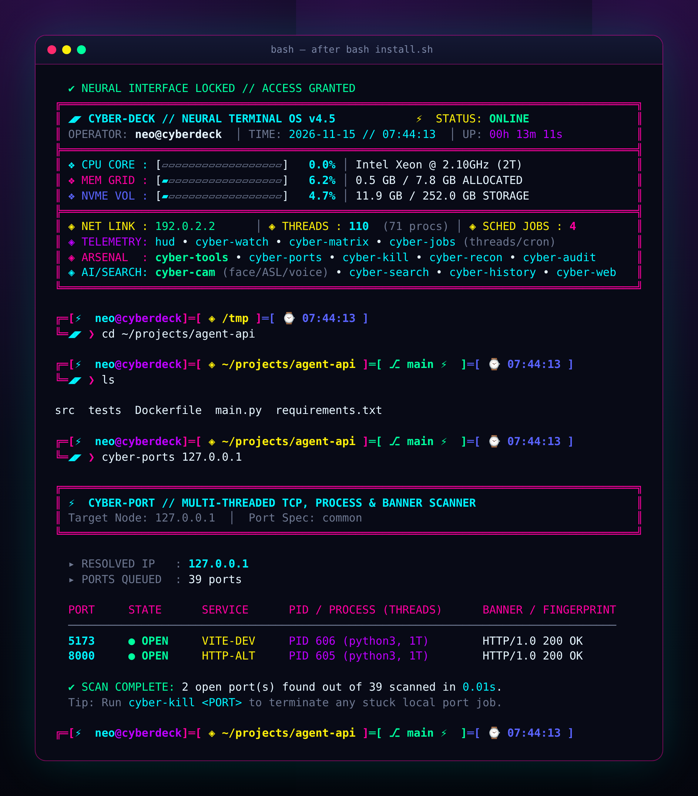
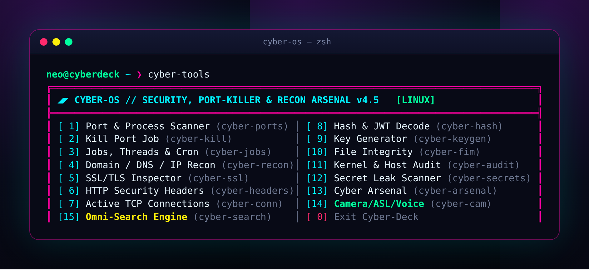
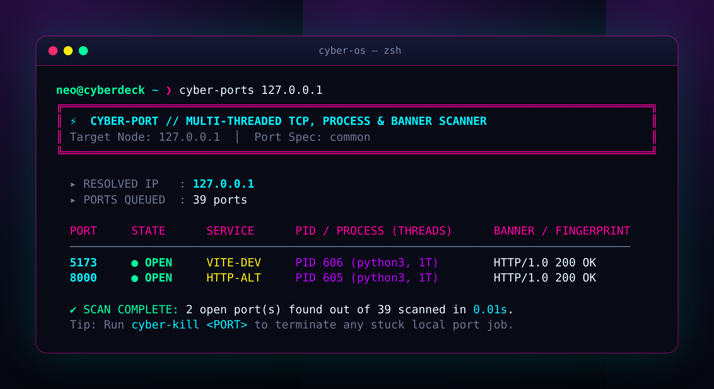

<div align="center">

# ⚡ CYBER-OS // NEURAL TERMINAL & SECURITY ARSENAL v4.5

**Zero-Dependency 24-Bit TrueColor Cyberpunk Sci-Fi Terminal HUD, Port Killer, Live Thread/Job Monitor & Cybersecurity Reconnaissance Suite**

[](LICENSE)
[](https://www.python.org/)
[](#cross-platform-installation)
[-fcee0a.svg?style=for-the-badge)](#-requirements)
[](CONTRIBUTING.md)

</div>

---

## 🌌 Overview

**CYBER-OS Terminal** transforms any terminal on **Linux, macOS, or Windows** into a high-contrast **24-bit TrueColor Cyberpunk Neon Cockpit** (`#00f3ff` Electric Cyan, `#ff00a0` Neon Magenta, `#00ff9f` Matrix Mint) packed with real-time hardware telemetry, live thread/process & cron job counters, instant port-killer utilities, and a 13-module cybersecurity reconnaissance & forensics suite.

<p align="center">
  
  <br><em>A fresh terminal after <code>bash install.sh</code>: the boot HUD, the neon prompt with git status, and <code>cyber-ports</code>.</em>
</p>

<p align="center">
  
  
</p>

> ⭐ **If this makes your terminal cooler, star the repo** — it helps other people find it.
> 🧑‍💻 **New to open source?** Pick any issue labeled [`good first issue`](https://github.com/abhisek11/cyber-os-terminal/issues?q=is%3Aissue+is%3Aopen+label%3A%22good+first+issue%22) — each one tells you which file to edit and how to test it.

---

## ✨ Key Features

- **📷 Neural Camera Vision, Face Detection, Age & Mood Detection, Hand Gestures, ASL Sign Language & Voice Cockpit (`cyber-cam`)**:
  - **Real-Time Face Detection**: Live HUD targeting reticles, 68-point facial landmark mesh, and operator presence detection (detection only; it does not yet identify who you are, see [#39](https://github.com/abhisek11/cyber-os-terminal/issues/39)).
  - **Live Operator Age & 7-Emotion Mood Detection**: Runs deep neural CNN (`AgeGenderNet` + `FaceExpressionNet` + 3D Landmark geometric fusion) to estimate **Operator Age (in years + age bracket + life stage)**, **Dominant Mood** (`😄 Happy`, `😐 Calm/Focused`, `😲 Surprised/Alert`, `😠 Intense`, `😔 Sad`, `😨 Tense`, `😒 Skeptical`), **Cognitive Focus %**, **Stress Index %**, and live emotion probability bars.
  - **21-Point 3D Hand Gesture Action Triggering**: Hold hand signs (`✌️ Peace` → Port Scan, `☝️ Point` → Live Threads & Jobs, `🤟 ILY` → Security Audit, `🤙 Shaka` → Browser History, `👍 Thumbs Up` → Omni-Search) to trigger real terminal operations hands-free!
  - **American Sign Language (ASL) Interpreter & TTS**: Recognizes ASL alphabet letters (`A`, `B`, `C`, `D`, `F`, `I`, `L`, `O`, `U`, `V`, `W`, `Y`) and signs (`HELLO`, `I LOVE YOU`, `YES`), builds words in a live sentence buffer, speaks them aloud via Neural TTS, or runs Omni-Search on them.
  - **Neural Voice Command Uplink**: Speak natural commands (*"detect my age and mood"*, *"biometric report"*, *"search files for..."*, *"search browser history for..."*, *"scan ports"*, *"kill port 8000"*, *"check jobs"*).
- **🌐 Omni-Search Engine (`cyber-search`, `cyber-find`, `cyber-history`, `cyber-web`)**:
  - **Deep Local File & Source Code Search (`cyber-find`)**: Fast filename matching and inside-file content grep with line numbers.
  - **Multi-Browser SQLite History Forensics (`cyber-history`)**: Safely queries Chrome, Firefox, Brave, Edge, and Chromium SQLite databases (even while locked by an open browser) across Linux, macOS, and Windows.
  - **Live Internet, Wikipedia & GitHub Intelligence (`cyber-web`)**: Queries DuckDuckGo, Wikipedia OpenSearch, and GitHub Repositories APIs simultaneously.
- **⚡ Real-Time Neural Telemetry HUD (`hud` / `cyber-watch`)**:
  - Instant CPU load, RAM allocation, NVMe/Disk usage, local IP, system uptime, **live thread count**, **active process count**, and **scheduled jobs counter**.
  - Zero external Python dependencies for the core HUD and security tools (pure standard library + native OS APIs). The camera cockpit loads MediaPipe from a CDN in your browser.
- **🎯 Port Scanner, PID Mapper & Instant Port Killer (`cyber-ports` & `cyber-kill`)**:
  - Multi-threaded TCP port & banner scanner that maps open ports directly to their owning **PID, Process Name, and Live Thread Count**.
  - Free any stuck development or server port (`3000`, `5000`, `8000`, `8080`, `11434`) with a single command: `cyber-kill 8000`.
- **🧵 Live Thread Counts, Process Telemetry & Scheduled Jobs Scanner (`cyber-jobs`)**:
  - Aggregates total active processes and **total live OS threads** across the system.
  - Ranks top processes by live thread count and memory footprint.
  - Audits scheduled jobs across User Crontab, `/etc/cron.*`, Systemd Timers, Active Service Daemons, and Windows Task Scheduler (macOS `launchd` support is [open for contributors](https://github.com/abhisek11/cyber-os-terminal/issues)).
- **🛡️ 13-Module Cybersecurity & Reconnaissance Arsenal (`cyber-tools`)**:
  - **Domain / IP Recon (`cyber-recon`)**: IPv4/IPv6 DNS resolution, Reverse PTR, ASN/ISP geolocation, and `dig` MX/NS/TXT interrogation.
  - **SSL/TLS Certificate Inspector (`cyber-ssl`)**: Audits TLS protocol version, cipher suites, X.509 issuer, SAN domains, and days until expiration.
  - **HTTP Security Header Auditor (`cyber-headers`)**: Evaluates HSTS, CSP, X-Frame-Options, X-Content-Type-Options, Referrer-Policy, and scores posture from `A+` to `F`.
  - **Crypto Hasher & Universal JWT/Payload Decoder (`cyber-hash` & `cyber-decode`)**: Computes MD5, SHA-1, SHA-256, SHA-384, SHA-512, BLAKE2b digests and decodes JWT tokens (with expiration check), Base64, Hex, and URL payloads.
  - **Quantum Key & Password Generator (`cyber-keygen`)**: CSPRNG high-entropy passwords, API bearer keys, AES-256 hex keys, and Shannon entropy calculation.
  - **File Integrity Monitor (`cyber-fim`)**: Creates SHA-256 directory baselines and detects unauthorized file modifications, additions, or deletions.
  - **Kernel & Host Security Audit (`cyber-audit`)**: Inspects ASLR, `kptr_restrict`, `dmesg_restrict`, Yama `ptrace_scope`, TCP SYN cookies, `/etc/shadow` permissions, and SUID binaries.
  - **Source Code Secret Scanner (`cyber-secrets`)**: Detects leaked AWS keys, private keys, GitHub/OpenAI/Slack tokens, and hardcoded credentials.
- **🖥️ 100% Cross-Platform & Terminal Agnostic**:
  - Runs on **Linux**, **macOS**, **Windows (PowerShell & Windows Terminal)**, and **WSL**.
  - Works inside Kitty, Alacritty, WezTerm, Ghostty, iTerm2, GNOME Terminal, Konsole, Windows Terminal, and VS Code Integrated Terminal.

---

## 📋 Requirements

| Needed for | What |
| :--- | :--- |
| Everything | Python **3.8+**, Git, a terminal with 24-bit TrueColor (Windows Terminal, iTerm2, Kitty, WezTerm, GNOME Terminal, VS Code…) |
| Nice icons in the prompt | A [Nerd Font](https://www.nerdfonts.com/) set as your terminal font |
| `cyber-cockpit` | `tmux` |
| `cyber-recon` DNS records | `dig` (dnsutils / bind) |
| `cyber-nmap` | `nmap` (falls back to the built-in scanner) |
| `cyber-cam` | A webcam, a Chromium-based browser, and internet access (MediaPipe loads from jsDelivr) |
| `cyber-cam --native` | `pip install opencv-python` |

`bash install.sh --packages` installs the optional native tools for you.

---

## 🚀 Cross-Platform Installation

### 🐧 Linux & 🍎 macOS (Bash & Zsh)

```bash
git clone https://github.com/abhisek11/cyber-os-terminal.git
cd cyber-os-terminal

# 1. Install shell profile & Cyberpunk Neon prompt
bash install.sh

# 2. (Optional) Also install native CLI tools (starship, btop, bat, eza, fzf, tmux, nmap, whois, dig)
bash install.sh --packages

# Activate immediately
source ~/.bashrc   # or: source ~/.zshrc
```

### 🪟 Windows (PowerShell & Windows Terminal)

```powershell
git clone https://github.com/abhisek11/cyber-os-terminal.git
cd cyber-os-terminal

# Install into your PowerShell $PROFILE
powershell -ExecutionPolicy Bypass -File .\install.ps1

# (Optional) Also install Starship & Nmap via winget
powershell -ExecutionPolicy Bypass -File .\install.ps1 -Packages
```

### 📦 Universal Python Package (`pip` / `pipx`)

```bash
pip install -e .
# Exposes `cyber-hud`, `cyber-tools`, `cyber-search` and `cyber-cam` on any OS
# (the short aliases like `hud` and `cyber-kill` come from the shell installer above)
```

### 🧹 Uninstall

```bash
bash install.sh --uninstall                                          # Linux / macOS
powershell -ExecutionPolicy Bypass -File .\install.ps1 -Uninstall   # Windows
```

The installer backs up your shell rc file to `<file>.cyber_backup` before editing it, and it copies `starship.toml` to `~/.config/starship.toml` (restore your own copy if you had one).

---

## 🕹️ Command Reference

| Command | Example | Description |
| :--- | :--- | :--- |
| **`hud`** | `hud` | Render the Cyberpunk Neon system, thread & job telemetry banner |
| **`cyber-watch`** | `cyber-watch` | Live auto-refreshing 1Hz telemetry cockpit monitor |
| **`cyber-matrix`** | `cyber-matrix` | TrueColor Cyberpunk digital rain animation |
| **`cyber-cockpit`** | `cyber-cockpit` | Launch split-pane Tmux Cyberpunk cockpit |
| **`cyber-cam`** | `cyber-cam` | Launch Live Camera Face ID, Age/Mood CNN, 3D Hand Gesture, ASL & Voice Cockpit |
| **`cyber-search`** | `cyber-search claude` | Omni-Search across Local Files, Browser History & Live Web simultaneously |
| **`cyber-find`** | `cyber-find "API_KEY" .` | Search local filenames and inside-file source code |
| **`cyber-history`** | `cyber-history github` | Search Chrome, Firefox, Brave, Edge & Chromium SQLite history |
| **`cyber-web`** | `cyber-web "langgraph agents"` | Search live Internet (DuckDuckGo, Wikipedia, GitHub Repos) |
| **`cyber-tools`** | `cyber-tools` | Open the interactive Cyber-Deck menu (13 security modules + camera cockpit + omni-search) |
| **`cyber-ports`** | `cyber-ports 127.0.0.1 1-1024` | Multi-threaded TCP port, PID/thread & banner scanner |
| **`cyber-kill`** | `cyber-kill 8000` | Identify and kill the process occupying port `8000` |
| **`cyber-jobs`** | `cyber-jobs` | Scan live thread counts, top processes & scheduled cron/timer jobs |
| **`cyber-recon`** | `cyber-recon github.com` | DNS, reverse PTR, ASN/Geo & MX/NS/TXT intelligence |
| **`cyber-ssl`** | `cyber-ssl github.com` | Inspect TLS version, cipher suite & X.509 cert expiry |
| **`cyber-headers`** | `cyber-headers https://github.com` | Audit HTTP security headers and calculate A+ to F grade |
| **`cyber-conn`** | `cyber-conn` | List active TCP sockets and listening local daemons |
| **`cyber-hash`** | `cyber-hash ./scifi_hud.py` | Compute MD5, SHA1, SHA256, SHA384, SHA512, BLAKE2b |
| **`cyber-decode`** | `cyber-decode "<jwt_or_b64>"` | Decode JWT tokens, Base64, Hex, and URL-encoded strings |
| **`cyber-keygen`** | `cyber-keygen 48` | Generate CSPRNG passwords, API keys, AES-256 keys & UUIDs |
| **`cyber-fim`** | `cyber-fim .` | Create or verify SHA-256 File Integrity Monitor baseline |
| **`cyber-audit`** | `cyber-audit` | Audit kernel hardening sysctls, file permissions & SUID binaries |
| **`cyber-secrets`** | `cyber-secrets .` | Scan directory for leaked API keys, tokens & private keys |
| **`cyber-arsenal`** | `cyber-arsenal` | Check status of native system security tools (`nmap`, `dig`, `nc`, etc.) |

---

## 🧠 Deep-Dive: AI Vision, Gym Biomechanics & Commercial Engagement Suites

### 1. 📷 Neural Camera Vision, Age & Mood Biometrics, ASL & Voice (`cyber-cam`)

Launched via `cyber-cam` (or `python3 cyber_vision.py`), this module opens a 60FPS WebRTC + MediaPipe + Deep CNN cockpit on `http://127.0.0.1:8765` (or native desktop OpenCV via `cyber-cam --native`):

- **Biometric Age & Gender Estimation**: Uses `AgeGenderNet` CNN with Exponential Moving Average (EMA) smoothing to display exact estimated age (`~25 YRS`), age bracket (`23–27y`), and operator life-stage classification.
- **7-Emotion Mood & Cognitive State Analyzer**: Classifies facial expressions into `😄 Happy`, `😐 Calm/Focused`, `😲 Surprised/Alert`, `😠 Intense`, `😔 Pensive`, `😨 Tense`, and `😒 Skeptical`, computing live **Cognitive Focus %**, **Stress Index %**, and **Head Pose Roll (°)**.
- **ASL Sign Language & 3D Hand Gesture Actions**:
  - Hold `✌️ Peace` (1.5s) → Runs Local TCP Port & PID Scanner
  - Hold `☝️ Point` (1.5s) → Scans Live OS Threads & Scheduled Cron/Systemd Jobs
  - Hold `🤟 I Love You` (1.5s) → Runs Kernel & Host Security Audit
  - Hold `🤙 Shaka` (1.5s) → Queries Multi-Browser SQLite History Forensics
  - Hold `👍 Thumbs Up` (1.5s) → Runs Unified Omni-Search on signed ASL buffer

---


## ⚠️ Responsible Use

The port scanner, recon, TLS and header tools are for systems **you own or are authorized to test**. Browser-history search reads your own local browser databases and never uploads them; omni-search does send your query to DuckDuckGo, Wikipedia and GitHub. The camera cockpit runs on `127.0.0.1` only.

Found a security bug? Please report it privately — see [SECURITY.md](SECURITY.md).

---

## 🤝 Contributing

CYBER-OS is built in the open and **every skill level is welcome** — Python, shell scripting, Windows/macOS knowledge, docs, design, or testing on your machine.

1. Browse [`good first issue`](https://github.com/abhisek11/cyber-os-terminal/issues?q=is%3Aissue+is%3Aopen+label%3A%22good+first+issue%22) or [`help wanted`](https://github.com/abhisek11/cyber-os-terminal/issues?q=is%3Aissue+is%3Aopen+label%3A%22help+wanted%22).
2. Comment on the issue so nobody duplicates your work.
3. Read [CONTRIBUTING.md](CONTRIBUTING.md), fork, and open a PR.

Have an idea for a new module or theme? Open a feature request.

## 📄 License

Distributed under the **MIT License**. See [LICENSE](LICENSE) for more information.
